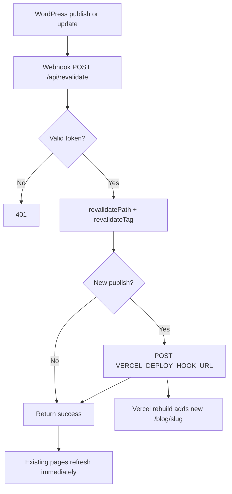

# CMS Publish Workflow And CPU Optimizations

This document describes the Vercel CPU optimizations applied to
**time-restricted.com**, how publishing from WordPress refreshes the frontend,
and how to configure automatic deploys for new post slugs.

Last updated: 2026-07-10.

---

## Why This Exists

The site prebuilds blog routes at deploy time (`dynamicParams = false`) to avoid
dynamic SSR cost from bot traffic probing random `/blog/*` URLs. That means:

- **Editing an existing post** → on-demand revalidation is enough.
- **Publishing a brand-new slug** → Vercel must rebuild so
  `generateStaticParams()` includes the new path.

Because you publish infrequently, the rebuild is triggered automatically through a
**Vercel Deploy Hook** wired into the existing WordPress revalidation webhook.

---

## Why not ISR-only?

Most headless WordPress + Next.js setups use **ISR with webhook revalidation** and
**no content deploys**:

| Concern | Typical pattern (ISR-only) | This project |
|---------|---------------------------|--------------|
| CMS updates | WordPress webhook → `/api/revalidate` | Same |
| New post slugs | Render on first request (`dynamicParams` defaults to `true`) | Prebuilt at deploy; unknown slugs **404** (`dynamicParams = false`) |
| Cache invalidation | `revalidatePath` / `revalidateTag` refresh lists and the post URL | Same for paths that already exist |
| Vercel Deploy Hooks | **Code and config only** — not for every publish | Also fired on **first publish** so `generateStaticParams()` picks up the new slug |

**Rule of thumb:** ISR + webhooks should handle all WordPress content; deploy hooks
belong to deployments, not the editorial workflow.

**Exception here:** We set `dynamicParams = false` on blog posts so bot traffic
probing random `/blog/*` URLs gets a cheap static 404 instead of dynamic SSR against
WordPress. That saves CPU, but it also means `revalidatePath('/blog/new-slug')`
cannot create a route that was never built — only a full rebuild (or flipping back to
`dynamicParams = true`) can.

So for **this** site:

- **Existing post edits** → webhook revalidation only (no redeploy).
- **Brand-new slugs** → webhook revalidation **plus** deploy hook (or wait for the
  next code deploy).
- **Code changes** → normal Git deploy; the deploy hook is not a substitute for that.

To match the ISR-only model instead, remove `dynamicParams = false` from
`app/blog/[slug]/page.tsx` and drop `VERCEL_DEPLOY_HOOK_URL` for content publishes.
New slugs would then render on demand after the webhook clears cache, at the cost of
more server work on garbage slug probes.

---

## CPU Optimizations Implemented

### Proxy / redirects

| Change | File | Effect |
|--------|------|--------|
| Redirection cache TTL default 24h | `proxy.ts`, `WORDPRESS_REDIRECTION_CACHE_TTL_SECONDS` | Fewer WordPress Redirection API fetches |
| Skip plugin lookup on first-party routes | `proxy.ts` | `/`, `/blog/*`, `/all-posts`, `/contact`, `/privacy-policy` skip Redirection scans |
| Legacy path redirects | `proxy.ts` | `/home`, `/posts`, `/all-posts-old`, `/sitemap.html`, dated URLs |

### WordPress data fetching

| Change | File | Effect |
|--------|------|--------|
| React `cache()` on post-list helpers | `lib/wordpress.ts` | Layout archives + adjacent posts share one pagination per request |
| Date-only archive query | `lib/wordpress.ts` | Sidebar archives fetch `date` only, not full post summaries |
| `revalidate: 3600` on GraphQL/REST | `lib/wordpress.ts` | Time-based cache fallback alongside webhooks |
| Split cache tags | `lib/wordpress.ts` | Post fetches use `wordpress-posts`; categories/pages use `wordpress` |
| Shared `getBlogPostPageData()` | `lib/wordpress.ts` | Metadata + page load post/SEO in one cached parallel fetch |
| Feed limited to 50 posts | `app/feed.xml/route.ts` | No full-archive fetch for RSS |

### Rendering / routing

| Change | File | Effect |
|--------|------|--------|
| Static 404 (no WordPress fetch) | `app/not-found.tsx` | Cheaper bot/migration 404 traffic |
| `prefetch={false}` on blog links | `app/layout.tsx`, `app/page.tsx`, `app/all-posts/page.tsx`, `app/blog/[slug]/page.tsx` | Fewer background RSC prefetches |
| `dynamicParams = false` | `app/blog/[slug]/page.tsx` | Unknown slugs 404 instead of dynamic SSR |

### Revalidation webhook

| Change | File | Effect |
|--------|------|--------|
| Narrow tag invalidation for single-post updates | `app/api/revalidate/route.ts` | Post edits clear `wordpress-posts` only |
| Deploy hook on new publish | `app/api/revalidate/route.ts`, `lib/vercel-deploy.ts` | New slugs trigger Vercel rebuild automatically |
| Revalidate `/feed.xml` on post changes | `app/api/revalidate/route.ts` | Feed stays current between deploys |

Further background and applicability notes live in
[`vercel-cpu-cost-control.md`](./vercel-cpu-cost-control.md).

---

## Automatic Publish Workflow



### Existing post updated

1. WordPress webhook hits `/api/revalidate?token=…`
2. Paths revalidated: `/blog/{slug}`, `/`, `/all-posts`, `/feed.xml`, `/sitemap.xml`
3. Cache tag cleared: `wordpress-posts`
4. **No deploy hook** (unless you pass `"deploy": true`)

### Brand-new post published

1. Same revalidation as above (immediate partial refresh)
2. Deploy hook fires when the payload looks like a **first publish**
3. Vercel rebuild runs `generateStaticParams()` and adds the new slug

---

## Setup: Vercel Deploy Hook

1. Open **Vercel → Project → Settings → Git → Deploy Hooks**
2. Create a hook for your production branch (for example `main`)
3. Copy the hook URL (looks like `https://api.vercel.com/v1/integrations/deploy/...`)
4. Add to Vercel environment variables:

```bash
VERCEL_DEPLOY_HOOK_URL=https://api.vercel.com/v1/integrations/deploy/prj_…/…
```

5. Redeploy once so the running app can read the new variable

The hook URL is a secret — treat it like a password. Do not commit it to Git.

---

## Setup: WordPress Webhook

Point your WordPress webhook plugin at the existing revalidation endpoint:

```text
POST https://time-restricted.com/api/revalidate?token=YOUR_REVALIDATE_SECRET
Content-Type: application/json
```

### Recommended payload

Send the WordPress post object when possible:

```json
{
  "post": {
    "post_name": "my-new-essay-slug",
    "post_status": "publish",
    "post_date_gmt": "2026-07-10 21:00:00",
    "post_modified_gmt": "2026-07-10 21:00:00"
  }
}
```

The endpoint also accepts:

- `"slug": "my-new-essay-slug"` (revalidation only; does **not** auto-deploy)
- WordPress-style `"post": { "post_name": "…" }` from common webhook plugins
- `"action": "created"` or transition fields for publish events

### When the deploy hook fires automatically

The revalidation handler calls the deploy hook when **any** of these are true:

| Signal | Example |
|--------|---------|
| Explicit flag | `"deploy": true` |
| Create action | `"action": "created"` |
| Status transition to publish | `"old_status": "draft"`, `"new_status": "publish"` |
| First-publish heuristic | `post_status` is `publish` and `post_date_gmt` ≈ `post_modified_gmt` (within 2 minutes) |

It does **not** deploy on routine updates to already-published posts.

### Force a deploy manually

```json
{
  "slug": "my-new-essay-slug",
  "deploy": true
}
```

### Disable deploy for one request

```json
{
  "post": { "post_name": "…", "post_status": "publish" },
  "deploy": false
}
```

---

## Webhook Response

Successful revalidation returns:

```json
{
  "revalidated": true,
  "paths": ["/", "/all-posts", "/feed.xml", "/sitemap.xml", "/blog/example-slug"],
  "tags": ["wordpress-posts"],
  "deploy": {
    "triggered": true,
    "ok": true,
    "message": "Deploy hook accepted."
  },
  "now": 1750000000000
}
```

If `VERCEL_DEPLOY_HOOK_URL` is unset, `deploy.triggered` is `false`.

---

## Environment Variables

| Variable | Required | Purpose |
|----------|----------|---------|
| `REVALIDATE_SECRET` | Yes | Authenticates webhook requests |
| `VERCEL_DEPLOY_HOOK_URL` | Recommended | Triggers production rebuild for new slugs |
| `WORDPRESS_REDIRECTION_CACHE_TTL_SECONDS` | Optional | Default `86400` in code |

---

## Verification Checklist

After configuration:

1. **Edit an existing post** in WordPress → page updates without a full Vercel deploy
2. **Publish a new post** → webhook response shows `deploy.triggered: true`
3. **Wait for Vercel deploy** → new `/blog/{slug}` returns 200 (not 404)
4. **Check Vercel Usage** → Fluid Active CPU should trend down over 24–48 hours

---

## Troubleshooting

| Symptom | Likely cause |
|---------|----------------|
| New post 404s after webhook | Deploy hook missing or failed; check response `deploy.ok` |
| Every edit triggers deploy | Webhook sends `"deploy": true` or `"action": "created"` on updates; adjust plugin |
| Updates feel stale | Revalidation token wrong, or webhook not firing |
| Deploy hook `ok: false` | Hook URL wrong/revoked; recreate in Vercel settings |

---

## Related Files

| File | Role |
|------|------|
| `app/api/revalidate/route.ts` | Webhook entry point |
| `lib/vercel-deploy.ts` | Deploy hook trigger logic |
| `app/blog/[slug]/page.tsx` | Static slug generation |
| `docs/vercel-cpu-cost-control.md` | Full CPU audit and applicability matrix |
